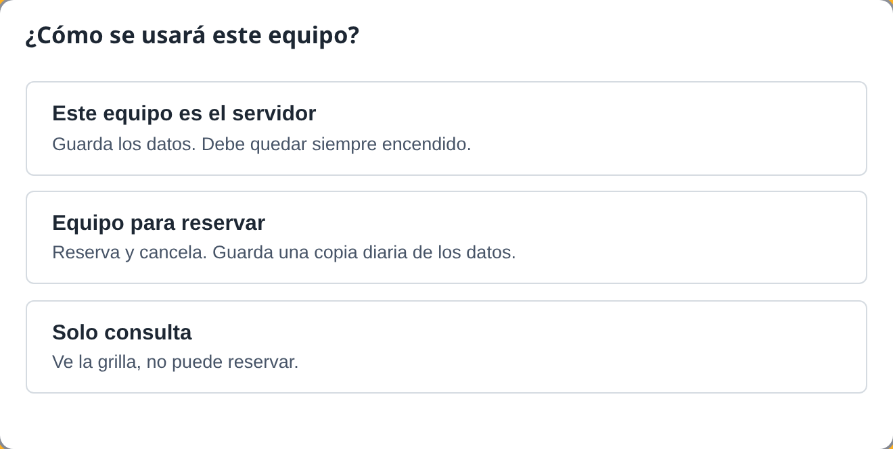

# 06 — Instalación y solución de problemas

Guía para TI o para quien deba instalar o reinstalar el sistema. No requiere saber programar.

## Obtener los instaladores

Los instaladores de la aplicación se generan de forma reproducible a través de GitHub Actions:

1. El responsable del proyecto abre el repositorio en GitHub y va a la pestaña **Actions**.
2. En la barra lateral izquierda, selecciona el workflow **Instalador Windows**.
3. Hace clic en el botón **Run workflow** sobre la rama deseada (`main` o `develop`) y confirma la ejecución.
4. Al completarse la tarea, descarga el artefacto **`instalador-windows`** (archivo comprimido `.zip` que contiene los instaladores `.msi` y `-setup.exe`).
5. **¿Cuál instalador usar?**
   - **`Gestion de Boxes_x.y.z_x64-setup.exe`** (NSIS): Es el instalador más simple y directo, recomendado para la instalación manual en los computadores del CESFAM.
   - **`Gestion de Boxes_x.y.z_x64.msi`** (WiX): Indicado si TI realiza una instalación administrada o automatizada mediante políticas de grupo (GPO).
6. Durante la construcción, el workflow descarga automáticamente la versión de NSSM auditada y comprueba su integridad mediante la suma SHA-256 (`99f5045fffbffb745d67fe3a065a953c4a3d9c253b868892d9b685b0ee7d07b8`), garantizando que los archivos del servidor empaquetados dentro de la app sean íntegros.

## Qué se instala dónde

En todos los computadores se instala el mismo instalador de la aplicación (`Gestion de Boxes_x.y.z_x64-setup.exe` o `Gestion de Boxes_x.y.z_x64.msi`). Al abrirla por primera vez, el asistente configura el modo del equipo ([ADR-020](../.ai-context/decisiones.md#adr-020--2026-11-06--aceptada--tres-modos-de-equipo-elegidos-al-instalar)):

| PC | Qué instalar | Modo a elegir en el asistente | Función |
|---|---|---|---|
| PC servidor (uno) | Instalador de la app (`.msi`) | **Este equipo es el servidor** | Guarda la base de datos principal, corre la API como servicio y permite reservar |
| Computadores de trabajo | Instalador de la app (`.msi`) | **Equipo para reservar** (`escritura`) | Permite reservar y cancelar; descarga una copia diaria de respaldo |
| Computadores de consulta | Instalador de la app (`.msi`) | **Solo consulta** (`lectura`) | Consulta la grilla y busca; no puede crear ni cancelar reservas |

> [!IMPORTANT]
> **Modos de equipo y respaldos:** Debe existir **al menos dos computadores con permiso de escritura contando el servidor** ([ADR-020](../.ai-context/decisiones.md#adr-020--2026-11-06--aceptada--tres-modos-de-equipo-elegidos-al-instalar)). Esto asegura que al menos un equipo cliente mantenga copias diarias actualizadas de los datos ([ADR-021](../.ai-context/decisiones.md#adr-021--2026-11-06--aceptada--copia-diaria-de-la-base-en-los-equipos-de-escritura)).

## Instalar el servidor desde la aplicación

1. En el computador designado como servidor, instala la aplicación ejecutando `Gestion de Boxes_x.y.z_x64.msi`.
2. Abre **Gestion de Boxes** desde el menú Inicio.
3. En la pantalla del asistente inicial (**"¿Cómo se usará este equipo?"**), haz clic en el botón **Este equipo es el servidor**.


4. Windows mostrará la ventana del Control de Cuentas de Usuario (UAC) solicitando permisos de administrador. **Acepta el aviso**.
5. La aplicación instalará y configurará automáticamente el servicio de fondo:
   - Crea `C:\ProgramData\GestionBox\` y su subcarpeta `backups\`.
   - Copia los ejecutables del servidor (`gestion-box-api.exe` y `nssm.exe`).
   - Registra el servicio de Windows **GestionBoxAPI** con inicio automático y reinicio ante caídas.
   - Abre las reglas en el Firewall de Windows para los puertos 8000/TCP y 8001/UDP.
   - Ajusta los planes de energía para evitar que el servidor se suspenda o hiberne (RNF-14).
   - Inicia el servicio y verifica la conexión local contra `http://127.0.0.1:8000/health`.
6. Una vez completado, la aplicación se conectará automáticamente a sí misma y mostrará la grilla de reservas lista para trabajar.

### Ahorro de energía en el servidor (el servidor no debe apagarse)

Para que los demás computadores del CESFAM puedan consultar y reservar durante la jornada, el PC servidor **debe permanecer siempre encendido**.

- Durante la instalación, el script ejecuta automáticamente:
  ```cmd
  powercfg /change standby-timeout-ac 0
  powercfg /change hibernate-timeout-ac 0
  ```
  desactivando la suspensión e hibernación automáticas cuando el equipo está conectado a la corriente (RNF-14).
- **Si aparece una advertencia indicando que falló el ajuste de energía** (o si directivas de grupo locales lo impidieron), configúralo a mano:
  1. En Windows, ve a **Inicio → Configuración → Sistema → Inicio/apagado y suspensión** (o abre el Panel de control → **Opciones de energía**).
  2. En el apartado de suspensión ("Con corriente alterna, suspender después de:"), selecciona **Nunca**.
  3. Si el servidor es un computador portátil, en "Elegir la acción del cierre de la tapa", selecciona **No hacer nada** al estar enchufado.

## Instalar los demás computadores (clientes)

1. En cada uno de los demás PCs, ejecuta `Gestion de Boxes_x.y.z_x64.msi` para instalar la app.
2. Abre **Gestion de Boxes** desde el menú Inicio.
3. En el asistente inicial:
   - Elige **Equipo para reservar** (`escritura`) en los puestos donde los funcionarios deban agendar y cancelar horas.
   - Elige **Solo consulta** (`lectura`) en boxes o puestos donde solo se requiera revisar la disponibilidad y buscar.
4. La aplicación buscará automáticamente al servidor en la red local mediante broadcast UDP. Si no lo encuentra en pocos segundos, solicitará por única vez el nombre del computador servidor (ej. `PC-SOME`) o su dirección IP.

## Copia diaria de la base de datos

Cada computador configurado como **Equipo para reservar** (`escritura`) descarga automáticamente una copia consistente de la base de datos desde el servidor ([ADR-021](../.ai-context/decisiones.md#adr-021--2026-11-06--aceptada--copia-diaria-de-la-base-en-los-equipos-de-escritura)):

- **Ubicación:** Las copias se guardan en el disco local de cada equipo de escritura en:
  ```
  C:\ProgramData\GestionBox\copias-del-servidor\
  ```
- **Nombre:** Siguen el patrón `gestion-box-AAAAMMDD-HHMMSS.db`.
- **Rotación:** Se conserva un historial de **7 copias locales** (las más recientes); al crearse una nueva copia se elimina automáticamente la más antigua.
- **Frecuencia:** Se descarga una copia una vez al día. La tarea de fondo se ejecuta al abrir la aplicación y luego cada hora, solicitando la copia mediante `GET /respaldo` únicamente si transcurrieron 24 horas o más desde la última.
- **Sin configuración:** La descarga ocurre de forma totalmente transparente e independiente; solo requiere que la app de ese equipo se abra al menos una vez al día durante la jornada laboral.

## Instalación manual con `instalar.bat` (alternativa)

La instalación del servidor también puede realizarse manualmente desde la carpeta `servidor\` sin pasar por el asistente de la app (por ejemplo, para servidores dedicados o si se desea precargar un archivo `boxes-iniciales.txt`):

1. Copia la carpeta `servidor\` (contiene `gestion-box-api.exe`, `nssm.exe`, `instalar.bat`, `desinstalar.bat`, `cargar-boxes.ps1` y el opcional `boxes-iniciales.txt`) al escritorio del PC servidor.
   Si se incluye `boxes-iniciales.txt` (codificación UTF-8, un nombre de box por línea) y la base está vacía, el instalador precargará dichos boxes.
2. Clic derecho en `instalar.bat` → **Ejecutar como administrador**.
3. El script ejecuta los pasos de configuración, abre el firewall, ajusta la energía e inicia el servicio.
4. Debe terminar con el mensaje **"Instalación completada"**.

### Parámetros opcionales de `instalar.bat`

- **`/sinpausa`**: Ejecuta el script sin detenerse en confirmaciones interactivas (`pause`). Es el parámetro utilizado por la aplicación para la instalación desatendida.
- **`/respaldo "<ruta>"`**: Si se proporciona una ruta válida a una copia de respaldo `.db` y la base en `C:\ProgramData\GestionBox\gestion-box.db` aún no existe, el script copia dicho archivo antes de iniciar el servicio. Se utiliza para restaurar datos en un servidor nuevo o durante la promoción de emergencia ([ADR-022](../.ai-context/decisiones.md#adr-022--2026-11-06--aceptada--promoción-a-servidor-oculta-solo-si-el-servidor-murió)).

## Desinstalar

- **Servidor:** Ejecuta `desinstalar.bat` como administrador. Detiene y elimina el servicio GestionBoxAPI y retira las reglas del firewall. **No borra** la base de datos ni las copias en `C:\ProgramData\GestionBox\` (deben borrarse a mano si se desea).
- **App:** Configuración de Windows → Aplicaciones → Aplicaciones instaladas → Gestion de Boxes → Desinstalar.

## Restaurar un respaldo en el servidor existente

Si la base de datos se dañó pero el computador servidor sigue operativo:

1. Abre una consola como administrador y detén el servicio:
   ```cmd
   C:\ProgramData\GestionBox\nssm.exe stop GestionBoxAPI
   ```
2. En `C:\ProgramData\GestionBox\backups\` elige el respaldo a restaurar (ej. `gestion-box-AAAAMMDD-HHMMSS.db`).
3. Aparta la base actual y sus archivos auxiliares de WAL para evitar corrupción:
   - Renombra `gestion-box.db` a `gestion-box.db.dañada`.
   - Si existen, renombra también `gestion-box.db-wal` a `gestion-box.db-wal.dañada` y `gestion-box.db-shm` a `gestion-box.db-shm.dañada`.
4. Copia el archivo de respaldo elegido a `C:\ProgramData\GestionBox\gestion-box.db`.
5. Inicia nuevamente el servicio:
   ```cmd
   C:\ProgramData\GestionBox\nssm.exe start GestionBoxAPI
   ```
   *(Al arrancar, la API crea automáticamente un nuevo respaldo en `backups\`; esto es normal y esperado).*
6. Abre la app y verifica que las reservas se visualicen correctamente.

## Si el servidor se daña

Esta función de emergencia permite que un equipo de trabajo para reservar (`escritura`) asuma
como nuevo servidor principal si el computador servidor anterior sufrió una falla definitiva, se
dañó de forma irrecuperable o no volverá a operar (ver [ADR-022](../.ai-context/decisiones.md#adr-022--2026-11-06--aceptada--promoción-a-servidor-oculta-solo-si-el-servidor-murió)).

### Cuándo usarla

- **Únicamente** cuando el PC servidor previo esté apagado o retirado definitivamente y no haya
  posibilidad de recuperarlo.
- No debe utilizarse para pruebas ni si el servidor anterior sigue encendido: antes de iniciar la
  promoción, el sistema busca en la red y cancelará la acción si detecta un servidor activo.

### Procedimiento

1. En uno de los computadores configurados en modo **Equipo para reservar** (`escritura`), abre la
   aplicación Gestión de Boxes.
2. Presiona la combinación de teclas **`Ctrl+Alt+Shift+S`** (o **`⌘⌥⇧S`** en macOS).
3. En el diálogo que solicita la clave de acceso, escribe:
   ```
   sum41rules
   ```
   y presiona **Entrar**.
4. Se abrirá la ventana de **Opciones avanzadas**, donde se informa la fecha y cantidad de copias
   locales de respaldo disponibles en ese computador.
5. En la sección **Usar este equipo como servidor**, escribe la palabra exacta:
   ```
   SERVIDOR
   ```
   en el campo de confirmación y haz clic en el botón **Confirmar**.
6. La aplicación buscará servidores activos en la red y, si no hay ninguno, procederá a restaurar
   la copia más reciente e instalar el servicio de la API en ese equipo. Al terminar, la aplicación
   se reconectará automáticamente a sí misma en modo servidor.
7. Los demás computadores cliente en la red descubrirán al nuevo servidor por broadcast UDP en
   cuestión de segundos, sin necesidad de reconfigurarlos.

### Pérdida de reservas

Debido a que los equipos de escritura descargan una copia de respaldo diaria del servidor (ver
[ADR-021](../.ai-context/decisiones.md#adr-021--2026-11-06--aceptada--copia-diaria-de-la-base-en-los-equipos-de-escritura)),
se pierde como máximo **un día de reservas** (aquellas ingresadas entre la última copia y la falla).
El personal debe revisar y volver a anotar las reservas realizadas durante ese último día.

### Reinstalación del equipo antiguo

El computador que operaba como servidor original **nunca** debe volver a encenderse en la red
con el servicio activo, para no provocar conflictos de doble servidor. Si en el futuro ese equipo se
repara o se reincorpora al CESFAM:

1. Ejecuta `desinstalar.bat` como administrador para eliminar el servicio GestionBoxAPI.
2. Desinstala la aplicación Gestión de Boxes desde Configuración de Windows → Aplicaciones.
3. Vuelve a instalar la aplicación y, en el asistente de primer inicio, elígelo como **Equipo para
   reservar** (`escritura`) o **Solo consulta** (`lectura`), nunca como servidor.

## Revisar el log

`C:\ProgramData\GestionBox\api.log` y `C:\ProgramData\GestionBox\servicio.log` se abren con el Bloc de notas. En `api.log`, cada línea tiene fecha,
hora, nivel (`INFO`, `WARN`, `ERROR`) y mensaje. Busca `ERROR` cerca de la hora del problema.

## Solución de problemas

| Síntoma | Qué revisar |
|---|---|
| Todas las apps dicen "Sin conexión" | ¿Está encendido el PC servidor? En él, abre `http://localhost:8000/health` en el navegador. Si no responde: `services.msc` → GestionBoxAPI → Iniciar. Revisa `api.log`. |
| Solo un PC no conecta | En ese PC: `ping PC-SOME`. Si falla, revisa cable/Wi-Fi o usa la IP del servidor en la pantalla de conexión. Verifica que esté en la misma subred. |
| El servidor cambió de IP | La app lo encuentra sola por broadcast. Si no, ingresa el nombre del PC (no la IP) en la pantalla de conexión. |
| El servicio no arranca | `api.log`, `servicio.log` y el Visor de eventos. Verifica que el puerto 8000 no lo use otro programa: `netstat -ano \| findstr :8000`. Comprueba que `nssm.exe` corresponda a la versión 2.24-101 o posterior. |
| "No se pudieron copiar los archivos" | Otro programa o servicio está usando `gestion-box-api.exe` o `nssm.exe`. Cerrar cualquier aplicación o consola abierta y reintentar. Si el servicio previo seguía corriendo, detenerlo con `nssm stop GestionBoxAPI`. Revisar el antivirus. |
| "No se pudo crear el box" al cargar boxes | El nombre del box ya existe en la base (duplicado) o el archivo `boxes-iniciales.txt` no está guardado en codificación UTF-8. Los boxes que falten se pueden agregar desde la app con el botón **⚙ Boxes**. |
| La búsqueda automática nunca funciona | El firewall bloquea 8001/UDP o la red bloquea broadcast. Re-ejecuta `instalar.bat`; si persiste, usa el nombre del PC. |
| "Ese bloque acaba de ser tomado" | Normal: otra persona reservó ese bloque segundos antes. Elige otro. |
| Disco lleno | Los respaldos del servidor se limitan a 30 y las copias diarias en clientes a 7; revisa otros archivos del PC. La base normalmente pesa pocos MB. |

## Compilar los entregables (desarrollo)

En un PC con Windows, Rust (MSVC) y Node.js:

```powershell
cargo build -p gestion-box-api --release
cd app; npm ci; npm run tauri build
```

Para generar el instalador destinado a PC sin internet, que incluye el instalador de WebView2 (el archivo resulta más grande):

```powershell
npm run tauri build -- --config src-tauri/tauri.offline.conf.json
```

Resultados:

- `target\release\gestion-box-api.exe`
- `target\release\bundle\msi\*.msi`
- `target\release\bundle\nsis\*-setup.exe`

`nssm.exe` (compilación 2.24-101-g897c7ad o posterior de 64 bits, no la versión 2.24 estable; consultar detalles de descarga y suma SHA-1 en `instalador/README.md`) se copia a `instalador\` antes de empaquetar la carpeta `servidor\`.
