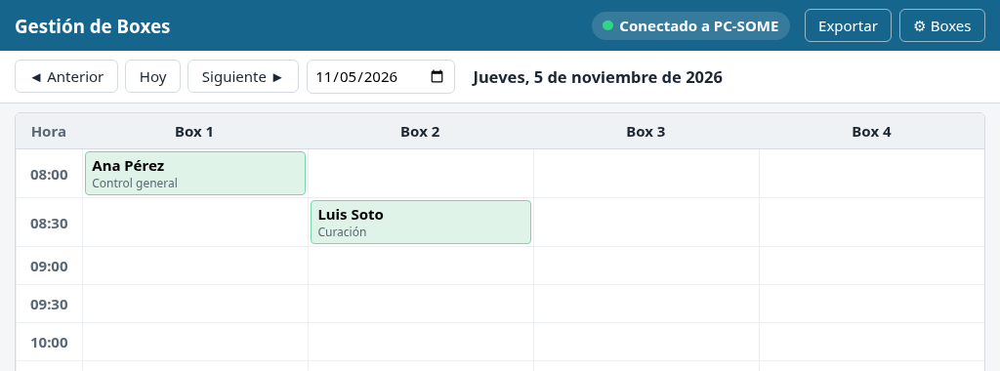
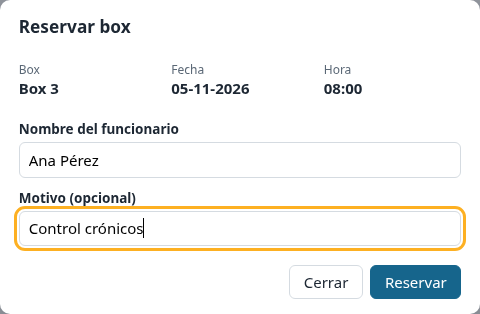
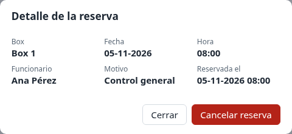

# Gestión de Boxes — Manual del funcionario

*Una página. Imprimible.*

## Abrir

Menú Inicio → **Gestion de Boxes**. Se abrirá la ventana **Gestión de Boxes** con la grilla del día: los boxes en columnas y los bloques horarios en filas.

## Reservar un box

1. Busca la hora deseada (fila) y el box (columna).
2. Haz clic en la **celda vacía**.
3. En el formulario, escribe tu nombre en **Nombre del funcionario** (el campo **Motivo (opcional)** no es obligatorio).
4. Presiona **Reservar**. Tu nombre aparecerá en la celda.

> Si aparece **"Ese bloque acaba de ser tomado"**, otra persona lo reservó un momento antes. Elige otro bloque u otro box.

## Ver o cancelar una reserva

1. Haz clic en la **celda con un nombre**.
2. Verás los datos de quién reservó y el motivo registrado.
3. Para liberar el box: presiona **Cancelar reserva** y luego confirma con **Sí, cancelar**.

## Cambiar de día

- **◄ Anterior** / **Siguiente ►**: retrocede o avanza un día.
- **Hoy**: vuelve de inmediato al día actual.
- **Selector de fecha** (junto a «Siguiente ►»): elige cualquier fecha en el calendario.

La grilla se actualiza sola cada 20 segundos; no hace falta cerrar y abrir la aplicación.

## Si dice "Sin conexión"

1. Revisa el mensaje: indica verificar que el PC servidor esté encendido y conectado a la red.
2. Verifica que **el PC servidor esté encendido** y que tu PC tenga red.
3. Espera unos segundos: la aplicación reintenta sola cada 20 segundos.
4. Si sigue sin conectar, avisa a TI indicando la hora.

**No se pierde nada**: las reservas quedan guardadas en el PC servidor.
